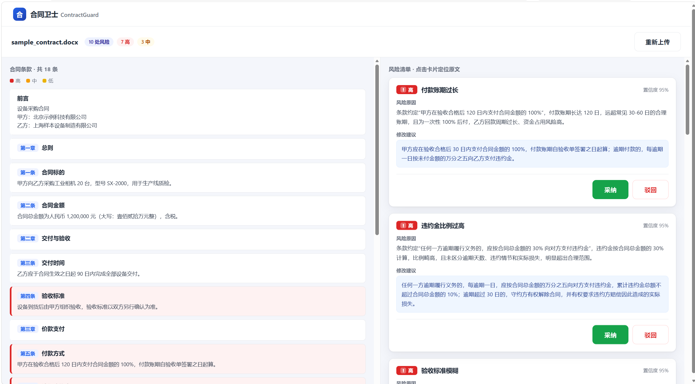
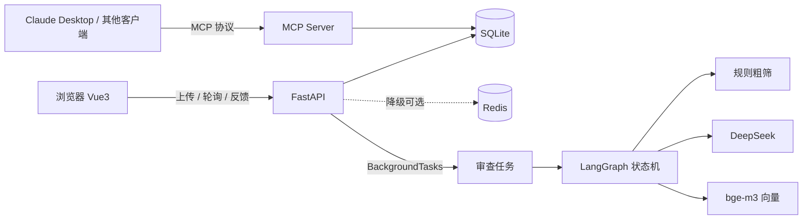

# 合同卫士 ContractGuard

**企业合同智能审查平台**：上传一份合同，几秒内得到「风险清单 + 原文定位 + 可直接采用的修改建议 + 风险等级」，法务只需做采纳/驳回决策。



> 左侧合同原文按风险等级高亮，右侧风险清单给出原因、修改建议与置信度，支持逐条采纳/驳回；底部可对合同直接提问，答案带原文引用。

---

## 核心指标

20 份可复现评测集上的实测结果（详见 [eval/report.md](eval/report.md)）：

| 指标 | 结果 |
| --- | --- |
| 风险召回率 | **100%**（86/86） |
| 误报率 | **0.0%**（0/86） |
| 字段抽取准确率 | **100%**（60/60） |
| 端到端耗时 | 中位 **3.3s**，P95 **3.9s** |
| 判定稳定性 | **Jaccard 1.000**（3 份 × 3 次，风险类型集合完全一致） |
| 单份成本 | **约 ¥0.009**（估算值） |

> ⚠️ 评测集为合成合同（条款结构固定、表述规整），指标偏乐观，真实合同预期显著更低。方法与局限见下文。

---

## 功能

- **上传与解析**：支持 PDF / DOCX，自动抽取文本、按条款切分，记录每条字符偏移与页码，供前端精确高亮定位
- **10 类风险识别**：违约金过高、账期过长、单方解除、管辖不利、缺赔偿上限、保密模糊、知识产权不明、验收模糊、自动续约、不可抗力过宽
- **异步审查 + 进度推送**：提交后立即返回 task_id，后台执行，前端轮询或订阅 SSE
- **报告页**：原文高亮、风险卡片、采纳/驳回，反馈落库并自动失效缓存
- **合同问答（RAG）**：混合检索（向量 + BM25 + RRF 融合）+ 两层拒答门控，答案强制标注出处，答不出时明确说「合同未约定」
- **MCP Server**：把条款检索等能力封装为标准 MCP 工具，可在 Claude Desktop 等客户端直接调用

---

## 架构



**分层**：API 层只做 HTTP 与校验 → 服务层承载能力（解析 / 切分 / 检索 / LLM）→ 编排层用 LangGraph 串流程 → 数据层 7 张表。

**关键约束**：LangGraph 节点是纯计算，不碰数据库。节点内有线程池并发，而 SQLAlchemy Session 不是线程安全的；持久化统一放在 API / 任务层。

---

## 技术栈

| 层 | 选型 |
| --- | --- |
| Web | FastAPI + uvicorn |
| 编排 | LangGraph + LangChain |
| 模型 | DeepSeek（生成）、BAAI/bge-m3（向量，1024 维） |
| 存储 | SQLite（向量以 JSON 存储，numpy 暴力余弦） |
| 缓存 | Redis（任务进度 / 分布式锁 / 报告缓存，可降级） |
| 前端 | Vue3（CDN 单文件，无构建步骤） |
| 工具协议 | MCP（mcp 2.x，MCPServer） |

---

## 快速开始

```bash
# 1. 创建环境
conda create -n hetong python=3.11 -y
conda activate hetong

# 2. 安装依赖
pip install -r requirements.txt

# 3. 配置
cp .env.example .env
# 填写 DEEPSEEK_API_KEY 与 SILICONFLOW_API_KEY

# 4. 启动
python run.py
```

- 界面：http://127.0.0.1:8000/
- API 文档：http://127.0.0.1:8000/docs

**Redis 是可选依赖**：未启动时自动降级（任务进度落数据库、跳过缓存与锁），不影响主流程。

**MCP 方式**（可选）：

```bash
python scripts/test_mcp.py     # 命令行自测 4 个工具
```

在 Claude Desktop 配置中追加：

```json
"contractguard": {
  "command": "<你的 python 路径>",
  "args": ["D:\\hetong\\mcp_server.py"]
}
```

---

## API 一览（14 个）

| 方法 | 路径 | 说明 |
| --- | --- | --- |
| POST | `/api/contracts` | 上传合同，同步完成解析与切分 |
| GET | `/api/contracts` | 合同列表（分页） |
| GET | `/api/contracts/{id}` | 合同详情（含条款） |
| GET | `/api/contracts/{id}/clauses` | 条款列表 |
| POST | `/api/contracts/{id}/review` | 提交异步审查，返回 task_id |
| POST | `/api/contracts/{id}/analyze` | 同步审查（评测脚本使用） |
| GET | `/api/contracts/{id}/report` | 审查报告（带缓存） |
| POST | `/api/risks/{id}/feedback` | 采纳 / 驳回 |
| POST | `/api/contracts/{id}/index` | 建向量索引 |
| POST | `/api/contracts/{id}/chat` | 基于合同问答 |
| GET | `/api/tasks/{id}` | 任务状态 |
| GET | `/api/tasks/{id}/stream` | 任务进度（SSE） |
| GET | `/health` | 健康检查 |
| GET | `/` | 前端页面 |

---

## 项目结构

```
app/
├── main.py              FastAPI 入口
├── config.py            配置（.env）
├── db.py                数据库连接
├── models.py            7 张表
├── schemas.py           请求 / 响应模型
├── api/                 contracts / tasks
├── services/            parser / splitter / llm / risk_rules /
│                        embedding / retriever / qa / review_service /
│                        task_runner / task_store / redis_client
└── graph/               state / nodes / build（LangGraph）
mcp_server.py            MCP Server（4 个只读工具）
scripts/test_mcp.py      MCP 自测
eval/                    gen_cases.py / run_eval.py / report.md
docs/                    截图
```

---

## 设计取舍

**1. 规则粗筛 + LLM 精判，而不是全量丢给模型**
18 条条款全量判定又慢又贵，而「违约金」「账期」这类风险的关键词是确定的。规则零成本筛出候选（约一半），模型只精判候选。规则同时可解释、可由业务方维护。

**2. 数值类风险必须做数值判断，不能只看位数**
早期用 `\d{2,}日` 判断账期过长，把「30 日」也判成风险；用 `\d{2,}%` 把「15%」判成过高。改为提取数值后与阈值比较（账期 > 60 日、违约金 > 20%），并支持「百分之三十」这类中文写法。

**3. 缺失型风险改由规则直判**
「全文是否约定赔偿上限」是全文级判断，而 LLM 精判只看单条条款。评测中这类风险 7/7 全部漏报，定位为架构缺陷后改为规则直判（规则扫的就是全文），召回率从 91.9% 提升到 100%。

**4. 拒答用两层门控**
第一层用向量余弦阈值（< 0.45 直接拒答，不调用 LLM）；第二层由模型判断给定条款能否回答。实测发现阈值只能挡住「完全无关」的问题（0.36），挡不住「相关但合同未约定」的问题（0.68，甚至高于某些可回答的问题），因此两层缺一不可。

**5. Redis 全链路可降级**
任务进度、分布式锁、报告缓存都走 Redis，但每个调用都有降级路径：Redis 不可用时落数据库、无锁执行、跳过缓存。实测 Redis 关闭后接口仍全部可用，且单次请求在 300ms 内失败而非等待系统超时。

---

## 评测方法与局限

**方法**：不找真实合同人工标注（成本高且易错），而是**先造题再答题**——用固定模板生成 20 份合同，每份随机注入 3~6 个已知风险，注入时即生成 ground truth。生成后做**双向自检**：注入的风险必须进入规则候选，未注入的条款不得进入候选，否则报错退出（这一步实际抓出过 6 份合同的误触发）。

复现：

```bash
python eval/gen_cases.py    # 生成 20 份合同 + labels（seed=42）
python eval/run_eval.py     # 跑评测，输出 eval/report.md
```

**局限**（重要）：

1. **合成数据偏乐观**：条款结构固定、表述规整，真实合同更长、更不规范
2. **风险类型固定 10 类**：真实合同的风险形态更复杂
3. **成本为 tiktoken 估算值**：非实际账单
4. **管辖规则只覆盖「对方所在地」视角**：约定「甲方所在地」对乙方不利的情况暂未覆盖
5. **任务在进程内执行**：服务重启会中断运行中的任务（启动时清理僵尸任务）；生产环境应换成独立 worker + 消息队列

---

## 已知限制

- SQLite 单机，无并发写优化；向量检索为暴力余弦，适合单份合同（数十条条款）规模
- 扫描件（图片型 PDF）无法抽取文本，接口明确返回 422 提示需要 OCR
- 前端为单页演示版，未做移动端适配与多用户隔离

---

## 后续计划

- [ ] 缺失型风险扩展到「缺少保密期限」「缺少争议解决条款」等
- [ ] 长文档分段检索（先定位章节，再检索条款）
- [ ] 评测集引入真实合同（脱敏）校准指标
- [ ] 独立 worker + 消息队列，支持多任务并发
